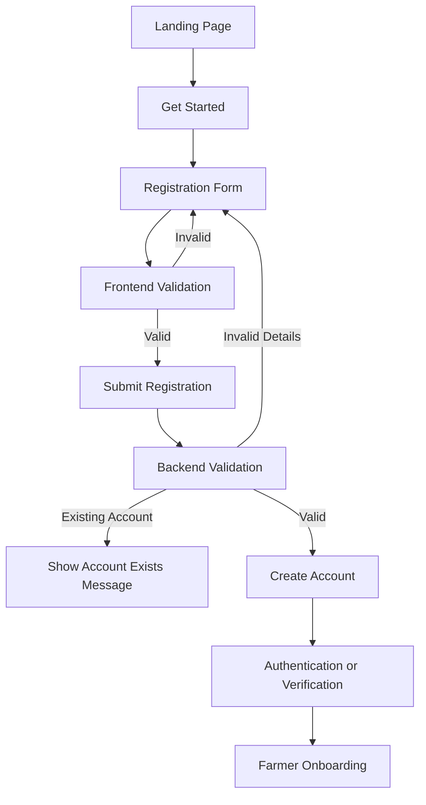
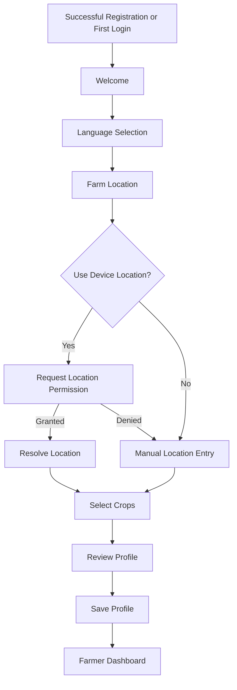
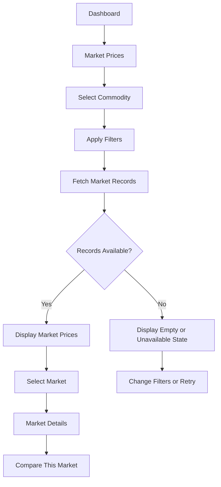
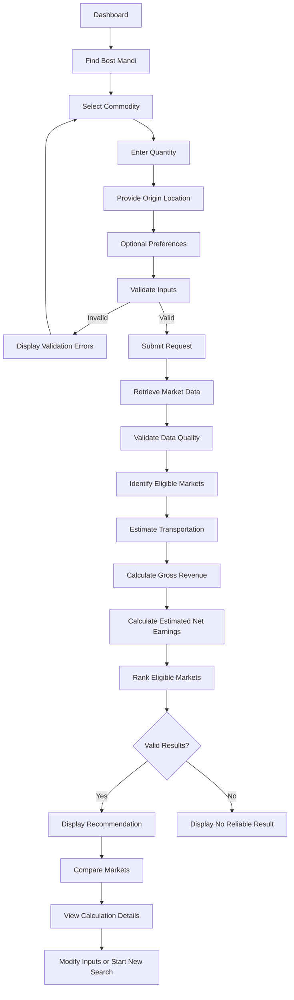
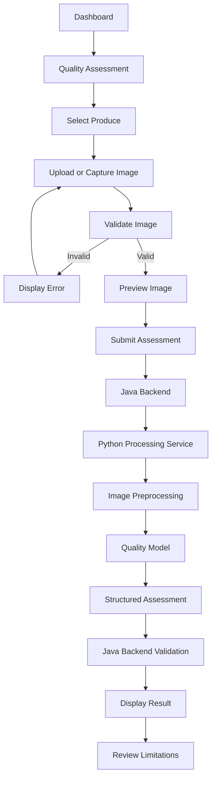
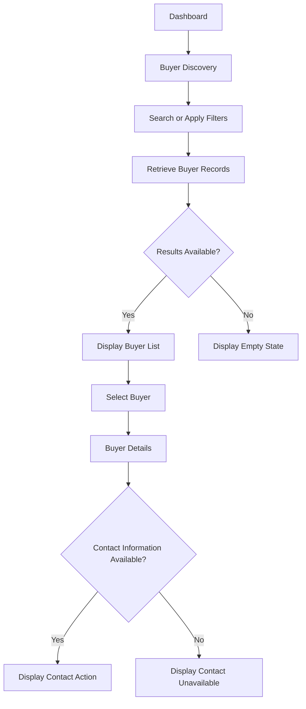
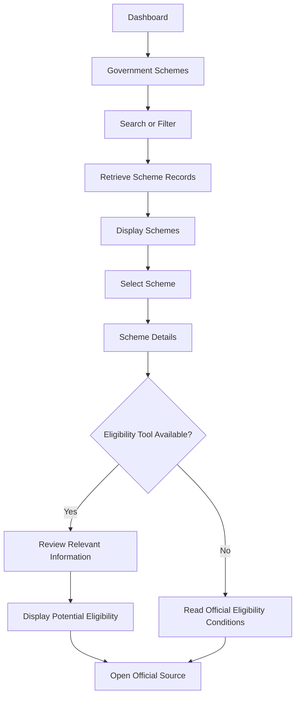
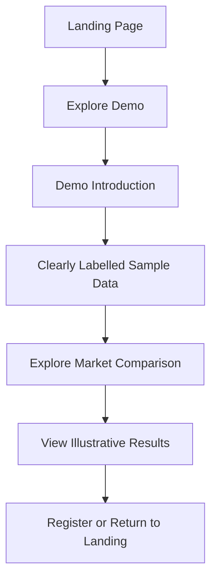
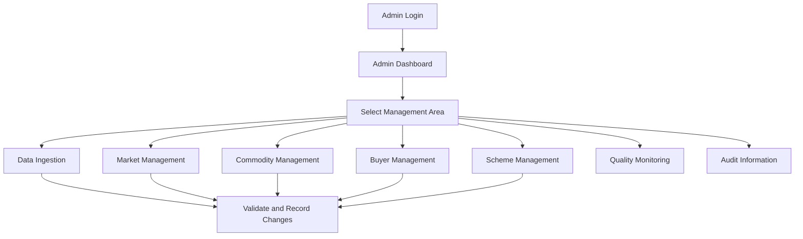
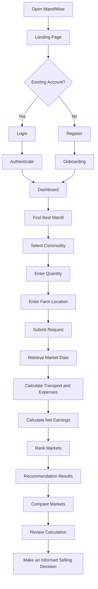

# MandiWise — Application Flow Document

**Document:** Application Flow  
**Project:** MandiWise  
**Version:** 1.0  
**Status:** Proposed Application Flow  
**Primary Users:** Farmers and Agricultural Producers  
**Secondary Users:** Administrators  
**Initial Geographic Scope:** Karnataka, India  
**Frontend:** React + TypeScript  
**Backend:** Java + Spring Boot  
**Database:** Supabase PostgreSQL  
**Specialised Processing Service:** Python + FastAPI

---

# 1. Purpose of This Document

This document defines the complete navigation structure, user journeys, screen transitions, workflows and application behaviour of MandiWise.

It describes how users interact with the application and how different features connect.

It serves as a reference for:

- Frontend development.
- Backend API integration.
- Navigation and routing.
- Authentication and authorisation.
- User onboarding.
- Market price exploration.
- Market comparison.
- Net earnings calculations.
- Historical price analysis.
- Image-based quality assessment.
- Buyer discovery.
- Government schemes.
- Agricultural insights.
- Administrative operations.
- Error handling.
- Testing and validation.

This document describes the intended application behaviour. It does not imply that any feature or route has already been implemented.

The implementation must follow the PRD, TRD, UI/UX Design Brief and Backend Schema.

---

# 2. Application Overview

MandiWise is an agricultural market intelligence and decision-support platform designed initially for Karnataka.

Its primary purpose is to help farmers make better decisions about where to sell their agricultural produce.

The application combines:

1. Agricultural market price information.
2. Market comparison.
3. Estimated transportation costs.
4. Estimated gross revenue.
5. Estimated net earnings.
6. Historical price trends.
7. Image-based produce quality assessment.
8. Buyer discovery.
9. Agricultural insights.
10. Crop rotation information.
11. Government scheme information.

The central workflow is:

**Farmer enters produce and location details → MandiWise retrieves eligible market information → estimates transportation and selling expenses → calculates net earnings → ranks suitable markets → explains the recommendation.**

The recommendation must be based on estimated net earnings rather than simply selecting the market with the highest displayed price.

---

# 3. User Roles

MandiWise will initially support three application access states.

## 3.1 Guest User

A guest user has not authenticated.

A guest can:

- View the landing page.
- Understand MandiWise features.
- View public information, if enabled.
- Explore the demonstration experience.
- Register.
- Log in.

A guest must not access protected farmer information.

The public landing page should not require authentication.

## 3.2 Farmer

A farmer is the primary application user.

An authenticated farmer can:

- View the dashboard.
- Manage their profile.
- Manage farm information.
- Explore market prices.
- Compare markets.
- Calculate estimated net earnings.
- View historical trends.
- Assess supported produce images.
- Explore buyers.
- View agricultural insights.
- Explore government schemes.
- Manage application settings.

Access to individual features may depend on their implementation status and available data.

## 3.3 Administrator

An administrator manages application information and operational data.

An administrator may access:

- Administrative dashboard.
- Market management.
- Commodity management.
- Market data ingestion and validation.
- Buyer management.
- Government scheme management.
- Data quality monitoring.
- Quality assessment monitoring.
- Administrative audit information.

Administrative access must be protected by role-based authorisation.

A farmer must never be able to access administrative operations simply by navigating to an admin URL.

---

# 4. Application Navigation Structure

The following route structure is proposed as the canonical frontend route map.

Routes can be refined during implementation, but their logical separation should be preserved.

## 4.1 Public Routes

| Route              | Page                     | Access                 |
| ------------------ | ------------------------ | ---------------------- |
| `/`                | Landing Page             | Public                 |
| `/login`           | Login                    | Public                 |
| `/register`        | Registration             | Public                 |
| `/forgot-password` | Password Recovery        | Public, if implemented |
| `/demo`            | Demonstration Experience | Public                 |

## 4.2 Farmer Routes

All routes under `/app` require farmer authentication.

| Route                                     | Page                       |
| ----------------------------------------- | -------------------------- |
| `/app/dashboard`                          | Farmer Dashboard           |
| `/app/markets`                            | Market Prices              |
| `/app/markets/:marketId`                  | Market Details             |
| `/app/find-best-mandi`                    | Market Recommendation Form |
| `/app/find-best-mandi/results/:requestId` | Recommendation Results     |
| `/app/trends`                             | Historical Price Trends    |
| `/app/quality-assessment`                 | Quality Assessment         |
| `/app/buyers`                             | Buyer Discovery            |
| `/app/buyers/:buyerId`                    | Buyer Details              |
| `/app/insights`                           | Agricultural Insights      |
| `/app/schemes`                            | Government Schemes         |
| `/app/schemes/:schemeId`                  | Scheme Details             |
| `/app/farm`                               | My Farm                    |
| `/app/settings`                           | Application Settings       |

The recommendation result route may use a persisted request identifier or another secure retrieval mechanism.

Sensitive user inputs must not be placed directly into public URL query parameters.

## 4.3 Administrative Routes

All routes under `/admin` require administrator authentication.

| Route                   | Page                           |
| ----------------------- | ------------------------------ |
| `/admin`                | Admin Dashboard                |
| `/admin/data-ingestion` | Data Ingestion                 |
| `/admin/markets`        | Market Management              |
| `/admin/commodities`    | Commodity Management           |
| `/admin/buyers`         | Buyer Management               |
| `/admin/schemes`        | Scheme Management              |
| `/admin/quality`        | Quality Assessment Monitoring  |
| `/admin/audit`          | Audit and Activity Information |

Only implement routes required by the approved administrative scope.

## 4.4 Route Protection Rules

1. Public routes must remain accessible without authentication.
2. Farmer routes require a valid authenticated farmer session.
3. Admin routes require administrator privileges.
4. Unauthenticated access to protected routes redirects to login.
5. After successful login, users should be redirected to their originally requested page when appropriate.
6. Authenticated users visiting login or registration should be redirected to their dashboard unless they intentionally log out.
7. Invalid or unauthorised route access must display an appropriate error or redirect.
8. Unknown routes must display a custom 404 page.

---

# 5. Global Application Layout

The application has two major visual environments.

## 5.1 Public Website Layout

Used for:

- Landing page.
- Public information.
- Login.
- Registration.
- Demonstration mode.

The landing page should use the approved cinematic MandiWise visual identity.

The public navigation may contain:

- MandiWise logo.
- Product overview.
- Features.
- How it works.
- About.
- Login.
- Get Started.

The landing page should have a visually distinctive hero section featuring the approved illustrated Karnataka countryside.

The hero should use carefully designed environmental motion and smooth content transitions.

## 5.2 Authenticated Application Layout

The farmer application should use a consistent SaaS-style interface.

### Desktop Layout

- Left sidebar.
- Top header.
- Main content region.
- Optional contextual actions.

### Sidebar Navigation

1. Dashboard.
2. Market Prices.
3. Find Best Mandi.
4. Price Trends.
5. Quality Assessment.
6. Buyer Discovery.
7. Agricultural Insights.
8. Government Schemes.
9. My Farm.
10. Settings.

### Header

May contain:

- Current page title.
- Breadcrumbs.
- Language selection.
- Notifications, if implemented.
- User profile menu.

### Mobile Layout

On smaller screens:

- Sidebar becomes a mobile navigation drawer or suitable compact navigation.
- Content becomes a single-column layout where appropriate.
- Tables must remain usable.
- Buttons and form controls must support touch interactions.
- Charts must adapt to available width.
- Important financial values must remain readable.

The application should preserve its visual identity across desktop, tablet and mobile.

---

# 6. First-Time Visitor Flow

The first-time visitor should understand the purpose of MandiWise quickly.

## 6.1 Landing Page

**Route:** `/`

The landing page introduces the product.

Suggested sections:

1. Cinematic illustrated hero.
2. MandiWise introduction.
3. How it works.
4. Find Best Mandi feature.
5. Market price exploration.
6. Historical trends.
7. Quality assessment.
8. Other agricultural features.
9. Trust and transparency.
10. Call to action.
11. Footer.

### Primary Action

**Find the Best Mandi**

Leads to registration or login if authentication is required.

### Secondary Action

**Explore Market Prices**

Leads to the relevant public experience if public market exploration is enabled. Otherwise, it prompts the user to authenticate.

### Other Actions

- Get Started → Registration.
- Login → Login page.
- Explore Demo → Demonstration mode.

### Landing Page Behaviour

- Hero illustration loads responsively.
- Environmental animations begin according to the motion design system.
- Text and CTA elements enter with coordinated transitions.
- Scroll-triggered sections appear progressively.
- Navigation transitions remain smooth.
- The page must remain usable when animation is disabled.

---

# 7. Registration Flow

**Route:** `/register`

Registration creates a farmer account.

## 7.1 Registration Screen

Suggested fields:

- Full name.
- Mobile number or email address, depending on the selected authentication method.
- Password.
- Confirm password.
- Terms and privacy acknowledgement.

Only collect information required for account creation.

Farm-specific information should generally be collected during onboarding or profile completion.

## 7.2 Registration Process

1. User opens registration.
2. User enters the required details.
3. Frontend validates field formats.
4. User submits the form.
5. Backend validates the request.
6. Backend checks whether the account already exists.
7. Password is securely hashed.
8. Account is created.
9. Authentication or account verification is completed according to the implemented security design.
10. User proceeds to onboarding or the dashboard.

## 7.3 Registration Validation

Handle:

- Missing required fields.
- Invalid email format.
- Invalid mobile number.
- Weak password.
- Password mismatch.
- Duplicate account.
- Invalid request.
- Network failure.
- Backend failure.

Display field-specific errors.

Do not expose internal server errors or sensitive account information.

## 7.4 Registration Flow Diagram

---

# 8. Login and Logout Flow

## 8.1 Login

**Route:** `/login`

### Login Screen

Fields:

- Email or mobile number.
- Password.

Actions:

- Login.
- Forgot Password, if implemented.
- Create Account.

### Login Process

1. User enters credentials.
2. Frontend validates the form.
3. User submits login request.
4. Backend verifies credentials.
5. Backend establishes the authenticated session.
6. Frontend retrieves the authenticated user profile.
7. User is redirected to the appropriate application page.

For a farmer, the default destination is:

`/app/dashboard`

For an administrator:

`/admin`

### Login Failure States

Handle:

- Incorrect credentials.
- Account not verified, if verification is required.
- Disabled account.
- Network error.
- Backend unavailable.
- Session creation failure.

Error messages must not disclose whether a particular account exists unnecessarily.

## 8.2 Session Expiration

If the authenticated session expires:

1. Frontend detects the unauthorised response.
2. If a secure refresh mechanism exists, it attempts session renewal.
3. If renewal fails, the user is redirected to login.
4. A clear session-expired message is displayed.
5. Unsaved form data should be preserved where practical and safe.

## 8.3 Logout

1. User opens profile menu.
2. User selects Logout.
3. Frontend invokes the appropriate logout operation.
4. Authentication tokens or session information are cleared according to the security design.
5. User is redirected to the landing page.

Protected information must no longer be accessible after logout.

---

# 9. Farmer Onboarding Flow

Onboarding collects the information necessary to personalise MandiWise.

It should be simple and should not feel like a lengthy registration process.

## 9.1 Onboarding Objectives

Collect relevant information such as:

- Preferred language.
- Farm location.
- District.
- Taluk, where relevant.
- Crops grown.
- Farm details, if needed by supported features.

Do not collect unnecessary sensitive information.

## 9.2 Onboarding Steps

### Step 1: Welcome

Display a brief introduction.

Explain how MandiWise helps farmers compare markets and understand potential earnings.

### Step 2: Language Selection

Allow the user to select an available language.

Initial language support:

- English.
- Kannada.

The selected language should persist in the user's preferences.

### Step 3: Farm Location

Allow the user to:

- Enter a location manually.
- Select a supported district or market location.
- Use device location if they explicitly grant permission.

Location permission must be optional.

If GPS permission is denied, the user must still be able to continue manually.

### Step 4: Crops

Allow users to select crops they commonly grow.

The crop list must come from supported application data.

### Step 5: Review

Display the collected information.

Allow the user to edit it before completion.

### Step 6: Complete Onboarding

Save the profile.

Redirect to:

`/app/dashboard`

## 9.3 Onboarding Flow

Users should be able to skip nonessential onboarding fields and complete them later.

---

# 10. Farmer Dashboard Flow

**Route:** `/app/dashboard`

The dashboard is the central starting point after login.

It should help the farmer understand available information and access important actions quickly.

## 10.1 Dashboard Loading

On entry:

1. Verify the authenticated session.
2. Retrieve the farmer profile.
3. Retrieve dashboard summary information.
4. Retrieve available market information relevant to the profile.
5. Retrieve relevant recommendations or insights, if available.
6. Render the dashboard.

Use skeleton loading states for major sections.

Do not block the entire dashboard if one optional section fails.

## 10.2 Dashboard Sections

### A. Welcome Section

Display:

- Farmer's name.
- Selected farm location, if available.
- A brief welcome message.

### B. Quick Actions

Display shortcuts:

- Find Best Mandi.
- Explore Market Prices.
- View Price Trends.
- Quality Assessment.

### C. Market Overview

Display relevant commodity prices where data is available.

Every price must include:

- Commodity.
- Market.
- Price.
- Unit.
- Observation date.

### D. Recommendation Summary

If a previous recommendation exists, display a summary.

Include:

- Recommended market.
- Expected price.
- Estimated transport expense.
- Estimated net earnings.
- Recommendation date.

### E. Agricultural Insights

Show available insights supported by data.

Do not populate this section with fabricated recommendations.

## 10.3 Dashboard Empty State

For a new user:

- Explain the main capabilities.
- Encourage the user to select a commodity.
- Provide a prominent Find Best Mandi action.
- Prompt the user to complete relevant farm details where necessary.

## 10.4 Dashboard Failure Behaviour

If market data is unavailable:

- Keep the dashboard accessible.
- Display a clear data-unavailable message.
- Show the last available observation only when its date is visible and the information is appropriate to display.
- Provide retry functionality.

---

# 11. Market Prices Flow

**Route:** `/app/markets`

This feature allows farmers to explore available agricultural market prices.

## 11.1 Market Prices Screen

Main components:

- Commodity selector.
- Location or district filter.
- Market selector.
- Date filter.
- Search.
- Sorting controls.
- Market price table or cards.

## 11.2 User Flow

1. Farmer opens Market Prices.
2. Application loads available commodities.
3. Farmer selects a commodity.
4. Farmer optionally selects a district or location.
5. Farmer optionally selects a date range.
6. Frontend sends the search request.
7. Backend retrieves eligible market records.
8. Results are displayed.
9. Farmer can sort or inspect a market.

## 11.3 Market Price Information

Each record should display:

- Commodity.
- Market name.
- District.
- Minimum price, if available.
- Maximum price, if available.
- Modal price, if available.
- Unit.
- Observation date.
- Source.

Do not assume every source record contains all price fields.

Unavailable fields must be represented as unavailable rather than zero.

## 11.4 Market Details

**Route:** `/app/markets/:marketId`

When a farmer selects a market:

Display available information:

- Market name.
- Location.
- District.
- Available commodity information.
- Price observations.
- Historical information where available.
- Data source.
- Observation dates.

Provide a relevant action:

**Compare This Market**

This should lead into the Find Best Mandi workflow with the selected market included as a candidate or comparison constraint, where supported.

## 11.5 Market Price Flow

---

# 12. Find Best Mandi — Primary User Journey

**Routes:**

- `/app/find-best-mandi`
- `/app/find-best-mandi/results/:requestId`

This is the central feature of MandiWise.

It helps farmers identify suitable markets by comparing estimated net earnings.

The system must not simply recommend the market with the highest displayed price.

It must account for estimated transportation expenses and other applicable selling expenses.

## 12.1 Entry Points

The user can access Find Best Mandi through:

- Dashboard quick action.
- Sidebar navigation.
- Landing page CTA after authentication.
- Market details page.
- Relevant agricultural insight.

## 12.2 Step 1 — Select Commodity

The farmer selects the commodity they want to sell.

The list must contain only supported commodities.

Initial commodity coverage must be determined by data feasibility and validation.

If a commodity is not supported:

- Explain that it is not currently available.
- Do not generate a fabricated recommendation.

## 12.3 Step 2 — Enter Quantity

The farmer enters the quantity they intend to sell.

Input:

- Quantity.
- Unit.

The initial application should use a clearly defined internal unit.

Recommended internal unit:

Kilograms (kg).

If the UI accepts quintals:

1 quintal = 100 kg.

The application must convert units correctly.

Validation:

- Quantity must be greater than zero.
- Quantity must be within configured application limits.
- Quantity must be numeric.
- Invalid or negative values must be rejected.

Do not assume that a market will purchase the entire entered quantity.

The displayed calculation is an estimate based on the entered quantity.

## 12.4 Step 3 — Provide Origin Location

The farmer provides the location from which the produce will be transported.

Options:

- Use saved farm location.
- Enter location manually.
- Select a supported location.
- Use device location after explicit permission.

GPS permission must never be mandatory.

If the origin cannot be resolved accurately:

- Ask the farmer to refine the location.
- Do not silently use an unrelated default location.

## 12.5 Step 4 — Optional Inputs

Depending on implemented capabilities, the farmer may provide:

- Quality information.
- Vehicle or transport preference.
- Additional selling expenses.
- Other relevant preferences.

Optional fields must not be displayed as fully functional unless the backend supports them.

Do not introduce quality-based price adjustments without reliable grade-to-price evidence.

## 12.6 Step 5 — Submit Request

After completing the form:

1. Frontend validates all inputs.
2. User submits the request.
3. Backend validates the request again.
4. Backend identifies eligible markets.
5. Backend retrieves suitable market price records.
6. Backend evaluates data freshness and completeness.
7. Backend calculates or retrieves market distances.
8. Backend estimates transportation expenses.
9. Backend calculates gross revenue.
10. Backend calculates estimated net earnings.
11. Backend ranks eligible markets.
12. Backend returns the result with calculation details and data metadata.

The backend must be the authoritative source for the final financial calculations and ranking.

## 12.7 Step 6 — Candidate Market Evaluation

A market should be eligible for recommendation only when the required information is sufficiently reliable.

Relevant checks:

- Market identity is valid.
- Commodity matches the request.
- Price record exists.
- Price unit is known.
- Observation date is available.
- Price record satisfies the freshness policy.
- Required calculation inputs are available.
- Distance or transport estimate can be obtained using the configured method.

If a candidate fails a required check, it should not silently receive an assumed value.

The application may display excluded markets separately when useful, explaining why they were excluded.

## 12.8 Step 7 — Financial Calculations

The application must use the following calculation definitions.

### Unit Conversion

1 quintal = 100 kg.

### Gross Revenue

Gross Revenue = (QuantityKg / 100) × ExpectedPricePerQuintal

### Total Expenses

Total Expenses = EstimatedTransportationCost + OtherApplicableSellingExpenses

### Estimated Net Earnings

Estimated Net Earnings = GrossRevenue − TotalExpenses

All calculations must use consistent units and currency.

Currency:

INR (₹).

The application should use appropriate decimal precision and rounding rules.

Do not calculate a market result when required input values are missing.

### Important Calculation Assumptions

The application must clearly communicate that:

- Modal price is not a guaranteed selling price.
- Market prices can change.
- Transportation cost is an estimate unless supported by a confirmed quote.
- Other expenses may apply.
- The market may not purchase the entire quantity.
- The calculation is not a guaranteed profit.

## 12.9 Step 8 — Market Ranking

Markets are ranked by estimated net earnings.

The market with the highest valid estimated net earnings should receive the primary recommendation indicator.

Do not rank markets solely by:

- Highest modal price.
- Shortest distance.
- Lowest transport cost.

If a market has the highest price but higher expenses, another market may be a better choice.

The ranking should be based on the calculated result.

If two markets have identical estimated net earnings, use a deterministic secondary ordering rule, such as lower estimated transport cost, and explain the ordering where necessary.

## 12.10 Step 9 — Results Screen

**Route:** `/app/find-best-mandi/results/:requestId`

### Primary Recommendation Card

Display:

- Recommended market name.
- District.
- Commodity.
- Expected price.
- Price observation date.
- Estimated gross revenue.
- Estimated transportation cost.
- Other expenses, if applicable.
- Estimated net earnings.

Highlight estimated net earnings prominently.

### Market Comparison List

Each candidate market should display:

- Market name.
- Expected price per quintal.
- Observation date.
- Distance.
- Distance type.
- Estimated transportation cost.
- Gross revenue.
- Other expenses.
- Estimated net earnings.
- Ranking position.

### Comparison Controls

Allow the farmer to:

- View market details.
- Compare markets.
- Review calculation details.
- Modify the input values.
- Start a new comparison.

## 12.11 Step 10 — Explain the Recommendation

MandiWise should explain why the recommended market ranks first.

Example:

"Market A is recommended because its estimated net earnings are higher than the other eligible markets after accounting for estimated transportation expenses."

Where appropriate, show the numerical breakdown.

The explanation must be derived from the actual calculation results.

Do not generate unsupported reasons.

## 12.12 No Suitable Market Found

If no market meets the required data-quality conditions:

Display:

"No reliable market comparison is available for these inputs right now."

Possible explanations:

- No matching market price records.
- Price observations are too old.
- Market distance cannot be estimated.
- Required calculation information is missing.
- The selected commodity is not currently supported.

Provide options to:

- Change the commodity.
- Change the origin location.
- Review another date range where applicable.
- Retry later.

Do not fabricate a recommendation to avoid showing an empty result.

## 12.13 Partial Market Data

If some markets have valid records and others do not:

- Display eligible markets.
- Explain that some markets were excluded.
- Show exclusion reasons where practical.
- Do not assign zero to missing transport or price information.
- Do not silently substitute sample records.

## 12.14 Recommendation Flow Diagram

---

# 13. Historical Price Trends Flow

**Route:** `/app/trends`

This feature allows farmers to understand how commodity prices have changed over time.

## 13.1 Entry

The farmer opens Price Trends from:

- Sidebar.
- Dashboard.
- Market Prices.
- Relevant recommendation details.

## 13.2 User Flow

1. Select commodity.
2. Select market or district.
3. Select date range.
4. Submit filters.
5. Backend retrieves historical records.
6. Frontend displays chart and summary.
7. Farmer explores the trend.

## 13.3 Chart Information

Where data is available, display:

- Price over time.
- Date.
- Market.
- Commodity.
- Price unit.
- Source.
- Observation frequency.

Use Recharts for chart rendering.

## 13.4 Chart Interactions

Support:

- Hover tooltips.
- Date selection.
- Market comparison where data is compatible.
- Zoom or range controls if useful.
- Responsive chart sizing.

## 13.5 Trend Interpretation

If the application provides trend summaries:

- Base them on actual historical records.
- Clearly distinguish observations from predictions.
- Explain the period being analysed.
- Avoid claiming that past trends guarantee future prices.

## 13.6 Empty State

If no historical data exists:

Display a clear message and allow the farmer to modify the filters.

Do not create artificial chart values.

---

# 14. Quality Assessment Flow

**Route:** `/app/quality-assessment`

Initial supported target:

Tomato quality assessment.

This feature uses a specialised Python processing service.

## 14.1 Entry

Farmer opens Quality Assessment.

The screen explains:

- Supported produce.
- Image requirements.
- What the assessment can identify.
- Limitations of visual assessment.

## 14.2 Select Produce

Initially, tomato should be the primary supported commodity.

Unsupported produce must not be processed as if the model supports it.

## 14.3 Upload or Capture Image

Allow:

- Image upload.
- Camera capture where supported.

Validate:

- File type.
- File size.
- Image readability.
- Image dimensions.
- Upload completeness.

Provide a preview before submission.

## 14.4 Consent and Processing

Explain how the image will be processed and retained according to the application's privacy policy.

The farmer submits the image.

Processing flow:

1. Frontend uploads image to Java backend.
2. Backend validates the upload.
3. Backend securely handles the image.
4. Backend sends the required processing request to Python FastAPI.
5. Python service preprocesses the image.
6. Model performs supported visual assessment.
7. Python returns structured results.
8. Java backend validates and processes the result.
9. Frontend displays the assessment.

The Python service is not the primary application backend.

## 14.5 Processing Screen

Display a meaningful processing state.

Possible stages:

- Uploading image.
- Validating image.
- Analysing image.
- Preparing assessment.

Do not display fake processing percentages.

## 14.6 Assessment Result

Display supported outputs only.

Possible information:

- Detected visual characteristics.
- Supported quality indicators.
- Predicted category or grade, if the model has been validated for it.
- Confidence information, if meaningful and properly calibrated.
- Limitations.

The interface must explain that image-based assessment is not a complete agricultural laboratory test.

Do not claim to determine:

- Internal quality.
- Taste.
- Chemical composition.
- Exact shelf life.
- Guaranteed market grade.

## 14.7 Quality-Based Price

Quality-based price estimation must only be introduced when reliable grade-to-price evidence exists.

If such evidence is unavailable:

- Do not display an invented price premium.
- Do not modify the market recommendation using unsupported quality assumptions.
- Keep quality assessment separate from financial calculations.

## 14.8 Failure States

Handle:

- Invalid image.
- Unsupported file type.
- File too large.
- Upload failure.
- Python service unavailable.
- Model processing failure.
- Uncertain assessment.
- Invalid model response.

Allow retry where appropriate.

## 14.9 Quality Assessment Flow

---

# 15. Buyer Discovery Flow

**Route:** `/app/buyers`

This feature helps farmers discover available buyers.

## 15.1 Buyer Discovery Screen

Display available buyer records.

Search and filtering may include:

- Buyer name.
- Location.
- Commodity interests.
- Verification status.

Only implement filters supported by the underlying data.

## 15.2 Buyer Cards

Where information is available, display:

- Buyer name.
- Location.
- Commodity interests.
- Verification status.
- Available contact information.

## 15.3 Buyer Details

**Route:** `/app/buyers/:buyerId`

Display:

- Buyer profile.
- Location.
- Supported commodity information.
- Verification status.
- Available contact details.
- Other verified information.

## 15.4 Contact Action

If contact information exists, provide an appropriate contact action.

Do not claim:

- That the buyer is currently purchasing.
- That the buyer will purchase the farmer's quantity.
- That the buyer guarantees a particular price.

Do not represent an unverified buyer as verified.

## 15.5 Buyer Discovery Flow

---

# 16. Government Schemes Flow

**Routes:**

- `/app/schemes`
- `/app/schemes/:schemeId`

This feature provides information about relevant agricultural government schemes and subsidies.

## 16.1 Scheme Listing

Display available scheme records.

Possible filters:

- Scheme category.
- Government department.
- State or central scheme.
- Eligibility category, where supported.

## 16.2 Scheme Cards

Each card may contain:

- Scheme name.
- Brief description.
- Issuing authority.
- Applicable region.
- Last verified date.
- Official source reference.

## 16.3 Scheme Details

Display:

- Full description.
- Benefits.
- Eligibility conditions.
- Required documents, if verified.
- Application procedure.
- Official website or source.
- Last verified date.

## 16.4 Eligibility Information

If eligibility assessment is implemented:

1. Retrieve relevant farmer profile information.
2. Ask only for additional necessary details.
3. Compare available information against documented eligibility criteria.
4. Display potential eligibility with an explanation.

The application must distinguish:

**Potentially eligible** from **Officially approved or confirmed eligible**.

MandiWise must not guarantee that a farmer qualifies.

It must not automatically submit scheme applications unless a separately approved feature supports that workflow.

## 16.5 Scheme Flow

---

# 17. Agricultural Insights and Crop Rotation Flow

**Route:** `/app/insights`

This feature provides agricultural information relevant to the farmer.

It may include:

- Crop rotation information.
- Commodity-related insights.
- Market observations.
- Agricultural recommendations supported by data.
- Relevant agricultural information.

## 17.1 Entry

Farmer opens Agricultural Insights.

The application retrieves:

- Relevant profile information.
- Selected crops.
- Available agricultural data.
- Supported insights.

## 17.2 Crop Rotation

If crop rotation guidance is implemented:

1. Farmer selects an existing crop or enters relevant crop information.
2. Application retrieves supported crop rotation information.
3. Application evaluates available context.
4. Application presents suitable information.
5. Application explains the rationale and limitations.

Do not generate a definitive recommendation when required agricultural information is missing.

## 17.3 Insight Presentation

Each insight should contain:

- Title.
- Description.
- Relevance.
- Supporting information.
- Source, where applicable.
- Date, where relevant.

Avoid presenting generic AI-generated content as verified agricultural advice.

## 17.4 Insufficient Information

If the application does not have enough information:

- Explain what is missing.
- Allow the user to update their profile.
- Avoid presenting unsupported recommendations.

---

# 18. My Farm Flow

**Route:** `/app/farm`

This section allows farmers to manage information relevant to their farm.

## 18.1 Information

Possible fields:

- Farm name, if applicable.
- Farm location.
- District.
- Taluk.
- Crops grown.
- Relevant farm details.

Only collect information required by supported features.

## 18.2 User Flow

1. Farmer opens My Farm.
2. Application retrieves saved information.
3. Farmer selects Edit.
4. Farmer modifies the relevant fields.
5. Frontend validates the form.
6. Backend validates the submitted information.
7. Changes are saved.
8. Updated information is displayed.

## 18.3 Location Changes

If the farmer changes their farm location:

- Update the saved location.
- Use the new location in future recommendations.
- Do not modify historical recommendation records silently.
- Ask the user to confirm location changes where necessary.

Previously generated recommendations should retain their original input context.

---

# 19. Settings Flow

**Route:** `/app/settings`

Settings allow the farmer to manage application preferences and account-related information.

## 19.1 Available Settings

Depending on implementation:

- Language.
- Account information.
- Password.
- Notification preferences.
- Accessibility preferences.
- Session management.
- Logout.

## 19.2 Language

Initially support:

- English.
- Kannada.

Language changes should update interface labels and relevant navigation text.

Avoid mixing languages inconsistently.

## 19.3 Account Changes

Sensitive changes such as password changes must follow appropriate authentication and validation procedures.

---

# 20. Demonstration Mode Flow

**Route:** `/demo`

Demonstration mode is intended for product demonstrations and testing when actual market information is unavailable or when a controlled sample scenario is needed.

## 20.1 Entry

The user selects Explore Demo.

The application opens a clearly identified demonstration experience.

## 20.2 Demo Behaviour

- Use predefined sample records.
- Clearly label sample data.
- Explain that the displayed results are illustrative.
- Allow users to explore supported interface interactions.
- Prevent sample records from being mistaken for actual market observations.

## 20.3 Data Separation

Demonstration data must remain separate from actual market records.

Never silently substitute sample data when an actual API or database query fails.

If actual data is unavailable, display an appropriate unavailable state rather than switching to sample data without disclosure.

## 20.4 Demo Flow

---

# 21. Administrative Application Flow

Administrative workflows are separate from farmer workflows.

Only authorised administrators may access them.

## 21.1 Admin Login

Administrator uses the authentication system.

After successful authentication:

`/admin`

## 21.2 Admin Dashboard

Display relevant operational information:

- Market data status.
- Data ingestion status.
- Number of supported markets.
- Number of supported commodities.
- Buyer record status.
- Scheme record status.
- Processing service status, where available.

Do not display invented operational metrics.

## 21.3 Data Ingestion

The administrator may:

1. Open Data Ingestion.
2. Select the configured source or ingestion process.
3. Trigger an authorised ingestion operation, if supported.
4. View ingestion progress.
5. Review validation results.
6. Inspect failed records.
7. Review ingestion logs.

All ingestion operations must be validated and auditable.

## 21.4 Market Management

Administrators may:

- View market records.
- Add or update market information.
- Correct invalid records.
- Manage supported market status.
- Review source information.

Changes to market data must preserve traceability.

## 21.5 Commodity Management

Administrators may:

- View supported commodities.
- Add or update commodity metadata.
- Manage supported units.
- Configure commodity availability.

Do not allow inconsistent unit definitions.

## 21.6 Buyer Management

Administrators may:

- Review buyer records.
- Update buyer details.
- Verify buyer information.
- Mark information as unverified when verification expires or fails.
- Maintain verification history where supported.

## 21.7 Scheme Management

Administrators may:

- Add scheme information.
- Update scheme descriptions.
- Update eligibility information.
- Maintain official source references.
- Update last-verified dates.

## 21.8 Administrative Flow

---

# 22. Global Loading, Empty and Error States

Every major screen must handle loading, empty, success and failure states.

These are not optional UI enhancements.

They are part of the expected application behaviour.

## 22.1 Loading States

Use appropriate loading indicators.

Examples:

- Skeleton cards.
- Skeleton tables.
- Chart placeholders.
- Button loading indicators.
- Progress indicators for longer processing operations.

Avoid unnecessary full-page loaders.

Where possible, keep existing content visible while refreshing data.

## 22.2 Empty States

Examples:

### No Market Records

"No market records are available for the selected commodity and filters."

### No Historical Data

"No historical price information is available for this selection."

### No Buyers

"No buyer records are currently available."

### No Schemes

"No scheme information matches your search."

### No Previous Recommendation

"You haven't compared any markets yet."

Each empty state should provide an appropriate next action.

## 22.3 Network Failure

If the frontend cannot communicate with the backend:

- Display a clear connection error.
- Preserve safe user input where practical.
- Provide retry.
- Do not display fabricated results.

## 22.4 Backend Failure

If the Java backend returns an unexpected failure:

- Display a user-friendly error.
- Log technical details appropriately.
- Do not expose stack traces or sensitive internal information.

## 22.5 External Data Source Failure

If AGMARKNET or another configured source is unavailable:

- Use previously stored records only when their dates and freshness are visible.
- Do not claim that the information is live.
- Do not silently replace missing data with sample data.
- Explain that current data could not be retrieved.

## 22.6 Python Service Failure

If the Python processing service is unavailable:

- Show that quality assessment could not be completed.
- Preserve the uploaded image only according to the application's retention policy.
- Allow a safe retry.
- Do not invent an assessment.

---

# 23. API Error Behaviour

The frontend should handle backend responses consistently.

The backend API design follows the standard response structure defined in the TRD.

Common HTTP status handling:

| HTTP Status | Meaning               | Frontend Behaviour                                     |
| ----------- | --------------------- | ------------------------------------------------------ |
| 400         | Bad Request           | Display request error                                  |
| 401         | Unauthenticated       | Attempt supported session renewal or redirect to login |
| 403         | Forbidden             | Display access denied                                  |
| 404         | Not Found             | Display not found state                                |
| 409         | Conflict              | Explain conflicting operation                          |
| 422         | Validation Error      | Display field-level validation                         |
| 429         | Too Many Requests     | Display retry guidance                                 |
| 500         | Internal Server Error | Display generic server error                           |
| 502         | Bad Gateway           | Display service communication error                    |
| 503         | Service Unavailable   | Display temporary unavailability                       |

The frontend must not assume every failed request has the same cause.

---

# 24. Data Freshness and Trust Indicators

MandiWise must communicate the status of information clearly.

Use the following labels consistently.

| Label      | Usage                                                  |
| ---------- | ------------------------------------------------------ |
| Actual     | Recorded information from the stated source            |
| Historical | Earlier market observation                             |
| Estimated  | Calculated estimate                                    |
| Predicted  | Model-generated future estimate                        |
| Sample     | Demonstration information                              |
| Verified   | Information that passed a defined verification process |
| Unverified | Information not yet verified                           |

For market prices:

- Display observation date.
- Display unit.
- Display source where available.
- Apply a defined freshness policy.
- Warn when information is older than the configured threshold.

A stale record may still be useful as historical information, but it must not be presented as a current market price.

The application must not use the word "live" unless the underlying source genuinely provides live information.

---

# 25. Global Interaction and Motion Behaviour

The application must follow the motion principles defined in `UI_UX_DESIGN_BRIEF.md`.

Motion is part of the user experience across the application.

## 25.1 Navigation

- Sidebar selection should transition smoothly.
- Page content should enter naturally.
- Active navigation indicators should animate.
- Dropdowns and menus should open and close smoothly.
- Mobile navigation should use appropriate drawer transitions.

## 25.2 Forms

- Focus states should transition smoothly.
- Validation messages should appear clearly.
- Buttons should provide immediate interaction feedback.
- Multi-step flows should have smooth transitions where appropriate.

## 25.3 Data

- Charts should animate when data is loaded.
- Financial values may count into their final values.
- Comparison results may enter with staggered animations.
- Ranking indicators should transition smoothly.

The final numerical values must remain accurate.

## 25.4 Loading

Use meaningful skeleton and progress states.

Do not use decorative loading animations that imply false progress.

## 25.5 Accessibility

Respect reduced-motion preferences.

All essential functionality must remain available without animation.

---

# 26. Navigation and State Preservation

The application should preserve useful context when users navigate between related screens.

Examples:

- Returning from market details should preserve previous market filters.
- Returning from recommendation results to the input form should preserve editable inputs where practical.
- Opening a market from a comparison should retain the original comparison context.
- Changing farm location should not silently rewrite previous recommendation records.
- Refreshing a recommendation result should retrieve the same saved request where supported.

Sensitive information must not be exposed through insecure client-side storage or URL parameters.

State preservation should follow the authentication and data security design.

---

# 27. Core End-to-End User Journey

This section describes the intended primary journey through MandiWise.

The primary journey begins when a farmer visits the application and ends when they receive a market comparison.

This is a decision-support workflow.

The final selling decision remains with the farmer.

MandiWise does not execute a sale or guarantee a buyer.

---

# 28. Important Application Rules

These rules apply across the entire application.

## 28.1 Market Data

- Never invent market prices.
- Every price must have an associated unit.
- Observation dates must be visible.
- Preserve source information.
- Missing values must not be interpreted as zero.
- Historical records must not be represented as live prices.
- Apply the configured freshness policy.

## 28.2 Financial Calculations

- Use kilograms internally or convert units consistently.
- 1 quintal = 100 kg.
- Calculate gross revenue using the defined formula.
- Include estimated transport expenses.
- Include other applicable selling expenses when supported.
- Calculate estimated net earnings.
- Rank eligible markets by estimated net earnings.
- Never claim guaranteed profit.

## 28.3 Transportation

- Distinguish road distance from straight-line distance.
- Clearly label estimated transportation costs.
- Do not present an estimate as a confirmed transport quote.
- Do not silently use zero transportation expense when the value is unavailable.

## 28.4 Quality Assessment

- Initial target is tomato.
- Only supported visual characteristics may be assessed.
- Do not claim internal quality from ordinary images.
- Do not generate unsupported price premiums.
- Clearly explain model limitations.

## 28.5 Buyers

- Maintain verification status.
- Do not invent buyers.
- Do not guarantee purchase availability.
- Do not claim that a buyer will purchase a particular quantity without verified information.

## 28.6 Government Schemes

- Use reliable source information.
- Maintain last-verified dates.
- Distinguish potential eligibility from confirmed eligibility.
- Do not guarantee approval.

## 28.7 Demonstration Mode

- Clearly label all sample information.
- Keep sample data separate from actual data.
- Never silently switch to demonstration data when actual data fails.

---

# 29. Accessibility and Usability Requirements

The application must be usable by farmers with different levels of technical familiarity.

Requirements:

- Clear and simple language.
- Understandable labels.
- Large enough touch targets.
- Clear input instructions.
- Visible validation errors.
- Readable numerical values.
- Consistent navigation.
- Responsive layouts.
- English and Kannada support.
- Appropriate accessibility contrast.
- Keyboard accessibility.
- Screen-reader-friendly controls.

Avoid unnecessary technical terminology in farmer-facing interfaces.

For example, prefer:

"Estimated money left after expenses"

alongside:

"Estimated Net Earnings"

when explaining financial calculations.

Do not overwhelm users with every technical detail at once.

Provide additional calculation explanations through expandable sections or detail views.

---

# 30. Application Flow Acceptance Checklist

The application flow should be considered implemented only after the relevant checks pass.

## Authentication

- [ ] Guest can access public pages.
- [ ] Registration works.
- [ ] Duplicate accounts are handled.
- [ ] Login works.
- [ ] Invalid credentials are handled.
- [ ] Protected routes are secured.
- [ ] Session expiration is handled.
- [ ] Logout works.

## Onboarding

- [ ] Language selection works.
- [ ] Manual location selection works.
- [ ] GPS permission is optional.
- [ ] Crop selection works where implemented.
- [ ] Profile information persists.
- [ ] Onboarding can be completed without unnecessary fields.

## Dashboard

- [ ] Dashboard loads.
- [ ] Quick actions navigate correctly.
- [ ] Market information displays dates and units.
- [ ] Empty states work.
- [ ] Failed optional sections do not break the entire dashboard.

## Market Prices

- [ ] Commodity selection works.
- [ ] Filters work.
- [ ] Price information is accurate.
- [ ] Observation dates are visible.
- [ ] Market details open correctly.
- [ ] Missing information is handled correctly.

## Find Best Mandi

- [ ] Commodity selection works.
- [ ] Quantity validation works.
- [ ] Unit conversion works.
- [ ] Origin location is handled correctly.
- [ ] Market data is validated.
- [ ] Transportation estimates are labelled.
- [ ] Gross revenue is calculated correctly.
- [ ] Net earnings are calculated correctly.
- [ ] Ranking uses estimated net earnings.
- [ ] Ineligible markets are handled correctly.
- [ ] No-data states work.
- [ ] Recommendation explanations are accurate.

## Historical Trends

- [ ] Filters work.
- [ ] Charts display correct information.
- [ ] Units and dates are visible.
- [ ] Missing historical records are handled.

## Quality Assessment

- [ ] Image upload works.
- [ ] Image validation works.
- [ ] Python service integration works.
- [ ] Processing states work.
- [ ] Assessment results are displayed correctly.
- [ ] Model limitations are communicated.
- [ ] Service failures are handled.

## Buyers and Schemes

- [ ] Buyer search works.
- [ ] Verification status is visible.
- [ ] Buyer details are correct.
- [ ] Scheme information is sourced.
- [ ] Last-verified dates are visible.
- [ ] Eligibility is not presented as guaranteed.

## General

- [ ] Navigation works.
- [ ] Unknown routes show 404.
- [ ] Loading states work.
- [ ] Error states work.
- [ ] Mobile layouts work.
- [ ] Motion is smooth and purposeful.
- [ ] Reduced-motion preferences are respected.
- [ ] Sample data is clearly labelled.

---

# 31. Implementation Dependencies

The application should be implemented in phases.

Not every flow needs to be developed immediately.

Suggested implementation order:

### Phase 1 — Foundation

- Project setup.
- Global layout.
- Design system.
- Public landing page.
- Authentication.
- Route protection.

### Phase 2 — Farmer Profile

- Onboarding.
- Language preference.
- Farm location.
- Crop information.
- Farmer dashboard.

### Phase 3 — Market Information

- Commodity selection.
- Market listing.
- Market details.
- Market price filters.
- Historical records.

### Phase 4 — Core Recommendation Engine

- Find Best Mandi form.
- Location handling.
- Market eligibility.
- Transportation estimation.
- Gross revenue.
- Estimated net earnings.
- Market ranking.
- Recommendation results.
- Comparison details.

### Phase 5 — Historical Trends

- Chart integration.
- Filters.
- Historical trend summaries.

### Phase 6 — Quality Assessment

- Image upload.
- Java-to-Python integration.
- Processing.
- Assessment results.

### Phase 7 — Additional Features

- Buyer discovery.
- Government schemes.
- Agricultural insights.
- Crop rotation.

### Phase 8 — Administration and Refinement

- Admin dashboard.
- Data management.
- Ingestion management.
- Audit information.
- Performance and accessibility refinement.

The actual order may be adjusted based on data feasibility and technical dependencies.

Each phase must be tested before proceeding to the next.

---

# 32. Relationship With Other Project Documents

This document must be read alongside:

| Document                 | Purpose                                                        |
| ------------------------ | -------------------------------------------------------------- |
| `PRD.md`                 | Defines product requirements and scope                         |
| `TRD.md`                 | Defines technical architecture and implementation technologies |
| `UI_UX_DESIGN_BRIEF.md`  | Defines visual identity, design system and motion              |
| `APP_FLOW.md`            | Defines navigation and user journeys                           |
| `BACKEND_SCHEMA.md`      | Defines database structure and relationships                   |
| `IMPLEMENTATION_PLAN.md` | Defines development phases and execution steps                 |

If a conflict exists:

1. Product scope should be checked against the PRD.
2. Technical decisions should be checked against the TRD.
3. Visual decisions should be checked against the UI/UX Design Brief.
4. Database decisions should be checked against the Backend Schema.
5. Development sequencing should be checked against the Implementation Plan.

Do not silently introduce conflicting requirements.

---

# 33. Final Application Experience

MandiWise should provide a coherent experience from the first visit to the final market comparison.

The landing page should create a memorable first impression through its cinematic, illustrated agricultural landscape.

The authenticated application should provide a clean and intuitive working environment.

The primary recommendation journey should be straightforward:

**Select produce → Enter quantity → Provide location → Compare markets → Understand expenses → Review estimated net earnings.**

Additional agricultural features should complement this primary journey rather than distract from it.

Every workflow must prioritise:

- Accuracy.
- Clarity.
- Transparency.
- Reliability.
- Accessibility.
- Ease of use.
- Consistent visual design.

The ultimate objective is to help farmers make more informed agricultural marketing decisions through reliable information and understandable calculations.

**MandiWise should not simply show farmers where prices are higher. It should help them understand where selling their produce may leave them with better estimated earnings.**
